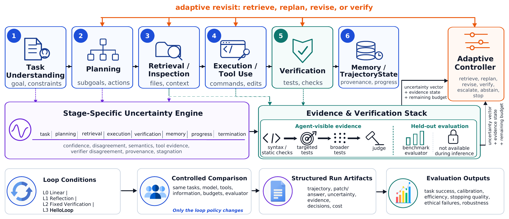

# HelloLoop

**A controlled audit of uncertainty-aware control loops for LLM agents**

[](https://www.python.org/)
[](LICENSE)

HelloLoop is a research framework for instrumenting long-horizon coding agents with explicit,
auditable control policies. It separates evidence visible to the agent from held-out evaluation,
records uncertainty and resource use at each stage, and supports controlled policy comparisons.

<p align="center">
  
</p>

The framework follows task understanding, planning, retrieval and inspection, execution and tool
use, verification, and memory/trajectory updates. Eight stage-specific uncertainty proxies feed
adaptive controls before a held-out evaluator determines the official outcome.

## What HelloLoop Does

- Records eight engineered uncertainty proxies for task, planning, retrieval, execution,
  verification, memory, progress, and termination.
- Compares L0 linear, L1 reflection, L2 fixed verification, and L3 uncertainty-aware control.
- Supports retrieval, replanning, revision, stronger verification, escalation, abstention, and stopping.
- Keeps agent-visible evidence separate from held-out benchmark evaluation.
- Produces auditable decisions, redacted trajectory summaries, token/cost records, and official outcomes.

## Why Use It

Researchers can audit uncertainty estimators, benchmark alternative control policies, study
calibration and selective prediction, compare registered and evaluated-only denominators, analyze
stopping and verification behavior, reproduce SWE-bench experiments, and replace the controller
without changing the base agent. The artifact also documents a useful negative result and the
engineering choices required to reproduce it.

## Key Findings

| Scope | Comparison | Registered resolution | Difference | Paired inference | Label |
|---|---|---:|---:|---:|---|
| Lite main | L0 vs. L3 | 55.0% vs. 45.0% | L0 +10.0 points | exact McNemar p = .125 | Confirmatory |
| Same-task replication | L0 vs. L3 | 47.5% vs. 42.5% | L0 +5.0 points | p = .688 | Replication |
| Both Lite executions | L0 vs. L3 | 51.2% vs. 43.8% | L0 +7.5 points | 95% CI [0.0, 16.3], p = .156 | Post-hoc |
| Verified holdout | L3 vs. L2 | 60.0% vs. 50.0% | L3 +10.0 points | p = .625 | Holdout |

The main L1 and L2 rates were 50.0% and 45.0%. Across 316 registered terminal runs, 291 reached
official evaluation, 289 submitted patches, 2 were evaluated abstentions, and 141 resolved. The
terminal registry also records 10 agent failures, 11 infrastructure failures, and 4 budget stops.
Frozen signal metrics were Brier 0.352, ECE 0.317, and AUROC 0.459. The grouped full-vector AUROC
was 0.411; its difference from the frozen signal was -0.048 (clustered 95% CI [-0.171, 0.075],
permutation p = .337). Conservative budget accounting was $132.20, including $44.60 in pre-model
reservations; token-derived measured expenditure was $87.61.

**Supported conclusion:** The evaluated broad uncertainty-aware controller shows no reliable
resolution or measured-cost advantage under the studied model, benchmark, provider route, and
resource limits. This does not establish equivalence or rule out other uncertainty-aware designs.

## Repository Map

| Path | Contents |
|---|---|
| `src/helloloop/` | Controllers, uncertainty estimators, adapters, runner, schemas, and evaluation |
| `configs/` | Four loop policies plus synthetic and user-supplied model examples |
| `data/` | Redacted run-level data, identifier-only manifests, schemas, and data card |
| `results/` | Frozen source tables/figures, processed signal data, checksums, and generated outputs |
| `scripts/` | Setup, smoke test, reproduction, validation, download, and security tools |
| `tests/` | Unit and offline integration tests |
| `docs/` | Architecture, reproduction, data dictionary, limitations, and inventories |

## Reproduction Pathways

### 1. Analysis Only

No model API key or network access is used. This regenerates summary metrics, tables, and figures
from frozen public CSV files and compares key values with the locked expectations.

```bash
python -m pip install -e ".[analysis]"
python scripts/reproduce_analysis.py
python scripts/validate_artifacts.py
```

Outputs are written to `results/generated/`; frozen inputs are never silently overwritten.

### 2. Offline Smoke Test

The deterministic synthetic fixture checks schemas, controller behavior, and analysis plumbing.
It makes no external or paid API call and its outputs are not empirical model evidence.

```bash
python scripts/run_smoke_test.py
```

### 3. Full Agent Experiment

Install the optional agent, model, data, and evaluation dependencies; obtain upstream benchmark
data with the download helper; configure Docker; and supply your own credentials through
environment variables. See [docs/reproduction.md](docs/reproduction.md). Provider behavior,
repository state, evaluator images, and model snapshots can drift, so new outcomes need not match
the frozen artifact. Costs are reported only when prices are explicitly configured.

## Quick Start

```bash
git clone https://github.com/Rocky5502/HelloLoop_V1.git
cd HelloLoop_V1
python -m venv .venv
source .venv/bin/activate
python -m pip install --upgrade pip
python -m pip install -e ".[analysis,dev]"
pytest -q
python scripts/run_smoke_test.py
python scripts/reproduce_analysis.py
python scripts/validate_artifacts.py
```

The equivalent entry points are `make setup`, `make test`, `make smoke`, `make reproduce`,
`make validate`, and `make check`.

## API Configuration

Analysis and smoke testing do not need credentials. For an explicitly requested model run:

```bash
cp .env.example .env
```

Fill `OPENAI_API_KEY`, `OPENAI_BASE_URL`, and `HELLOLOOP_MODEL` locally, set
`HELLOLOOP_OFFLINE=0`, and edit a copy of `configs/models/example_model.yaml`. `.env` files are
ignored. Never commit credentials or endpoint account metadata.

## Data And Artifacts

The repository includes a 316-row redacted run table, processed uncertainty predictions,
analysis-ready tables, identifier-only task manifests, schemas, provenance, figures, and SHA-256
checksums. It excludes raw prompts, patches, unredacted trajectories, request identifiers, private
paths, credentials, hidden tests, gold patches, evaluator images, and upstream repositories.
Download upstream resources under their own terms using `scripts/download_third_party_data.py`.
See [data/DATA_CARD.md](data/DATA_CARD.md) and [docs/data_dictionary.md](docs/data_dictionary.md).

## Limitations And Responsible Use

The study covers one model snapshot and provider route on repository-level Python tasks. Provider
drift, evaluator drift, and benchmark contamination remain possible. The eight signals are
engineered proxies, not calibrated probabilities. Full-vector and intervention analyses are
post-hoc over fixed trajectories; intervention subsets do not identify causal effects. The results
provide no evidence of real-world autonomous safety and should not be used to authorize unattended
deployment. More detail is in [docs/limitations.md](docs/limitations.md).

## Citation

Citation metadata is provided in [CITATION.cff](CITATION.cff). The public author list and archival
identifier are intentionally omitted until verified.

## License

Original HelloLoop code is available under the [MIT License](LICENSE). Data and external resources
retain their source-specific terms; see [THIRD_PARTY_NOTICES.md](THIRD_PARTY_NOTICES.md) and the
data card. No third-party source or benchmark payload is vendored.
